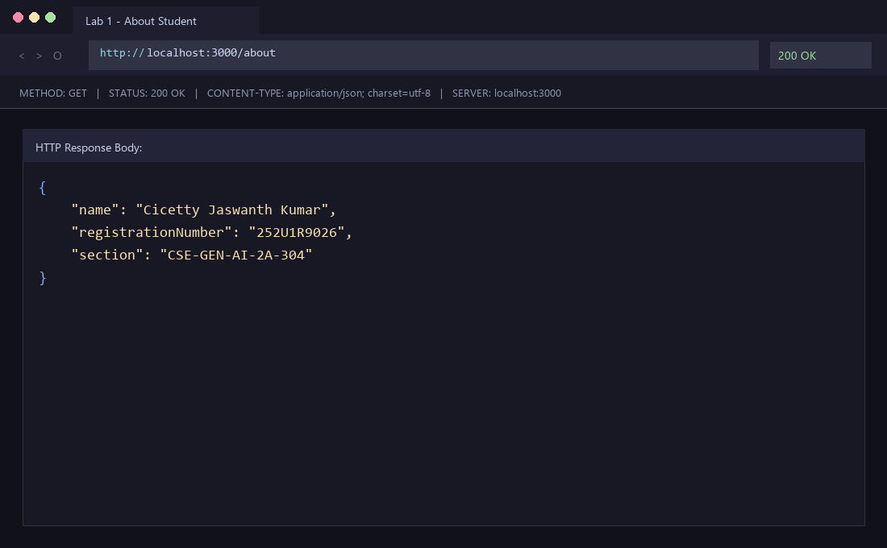

# Lab 1: Node.js and Express Server

## Student Details

- **Name:** Cicetty Jaswanth Kumar
- **Registration Number:** 252U1R9026
- **Section:** CSE-GEN-AI-2A-304
- **Course:** Backend Development Fundamentals
- **Lab Number:** 01

## Live Link

**Deployment URL:** https://backend-development.vercel.app/

## Objective

To set up a Node.js project, create a basic HTTP server using the built-in `http` module, and build an Express server with multiple routes and appropriate HTTP status codes.

## Technologies Used

- Node.js
- Express.js
- JavaScript
- npm
- Visual Studio Code

## Project Structure

```text
Backend_Development/
├── screenshots/
│   ├── home.png
│   ├── about.png
│   ├── time.png
│   └── not-found.png
├── .gitignore
├── README.md
├── package.json
├── package-lock.json
├── server-http.js
└── server.js
```

## Installation and Setup

### Prerequisites

- Node.js and npm installed
- Visual Studio Code or another code editor

### Steps to Run

1. Clone the repository or download the project.
2. Open the project root folder in the terminal:

   ```bash
   cd Backend_Development
   ```

3. Install the dependencies:

   ```bash
   npm install
   ```

4. Start the Express server:

   ```bash
   node server.js
   ```

   *(or run via npm script)*:

   ```bash
   npm start
   ```

5. Open the following URL in your browser:

   `http://localhost:3000`

### Run the Basic HTTP Server

To run the server implemented using Node.js's built-in HTTP module:

```bash
node server-http.js
```

*(or run via npm script)*:

```bash
npm run start:http
```

> **Note:** Stop the running server with `Ctrl + C` before starting another server on the same port to avoid port collision errors (`EADDRINUSE`).

## Endpoints

| Method | Endpoint | Description | Expected Status |
|:---:|:---:|:---|:---:|
| GET | `/` | Returns a welcome message | 200 OK |
| GET | `/about` | Returns student name, registration number, and section as JSON | 200 OK |
| GET | `/time` | Returns the current date and time using `new Date()` | 200 OK |
| GET | `/anything` | Demonstrates the response for an unknown route | 404 Not Found |

The `/anything` path is an example of an unknown route. Other undefined paths should also return a 404 response.

## Screenshots

### 1. Home Route

Displays the welcome message.


### 2. About Route

Displays the student's name, registration number, and section in JSON format.



### 3. Time Route

Displays the current date and time.


### 4. Unknown Route

Displays the 404 Page Not Found response.


## HTTP Status Codes

- **200 OK:** The request was successful and the resource was returned.
- **404 Not Found:** The requested route does not exist.

## Viva Questions

### 1. What is the difference between `package.json` and `node_modules`?

`package.json` stores project metadata, scripts, and dependency information (committed to Git). `node_modules` contains the physical installed packages required by the project downloaded by npm (ignored via `.gitignore`).

### 2. What does `app.listen()` do?

`app.listen()` starts the Express server and makes it listen for incoming requests on a specified port.

### 3. What do `request` and `response` represent?

- `request` (`req`): Contains information about the incoming HTTP request from the client (headers, URL, query parameters, body).
- `response` (`res`): Used to send data, headers, and HTTP status codes back to the client.

## Problems Faced and Solutions

1. **Port Collision (`EADDRINUSE: address already in use :::3000`):**
   - *Problem:* Running `node server.js` exited with code 1 because port 3000 was already bound by an existing background Node.js process.
   - *Solution:* Located the process using PowerShell (`Get-NetTCPConnection -LocalPort 3000`) and terminated it using `Stop-Process -Id <PID> -Force` before restarting the server.

2. **404 Middleware Placement:**
   - *Problem:* If the 404 handler middleware is declared before the route definitions, it intercepts all incoming requests before they reach their intended endpoints.
   - *Solution:* Registered `app.use(...)` at the very end of `server.js` after all defined route handlers so that only unmatched routes trigger 404.

3. **Vercel Serverless Function Compatibility:**
   - *Problem:* Standard local Express apps only invoke `app.listen()`. When deploying to Vercel, the serverless platform requires the Express application instance itself to be exported.
   - *Solution:* Added `module.exports = app;` to `server.js` so Vercel can import and serve the handler as a serverless function without errors.

## Git and Repository Notes

- The `.gitignore` file excludes `node_modules/` and `.env`.
- The `node_modules/` directory must not be committed.
- Screenshots are stored in the `screenshots/` directory.
- The project is submitted through the course GitHub repository.
