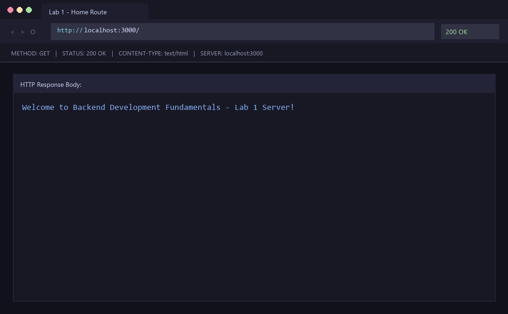
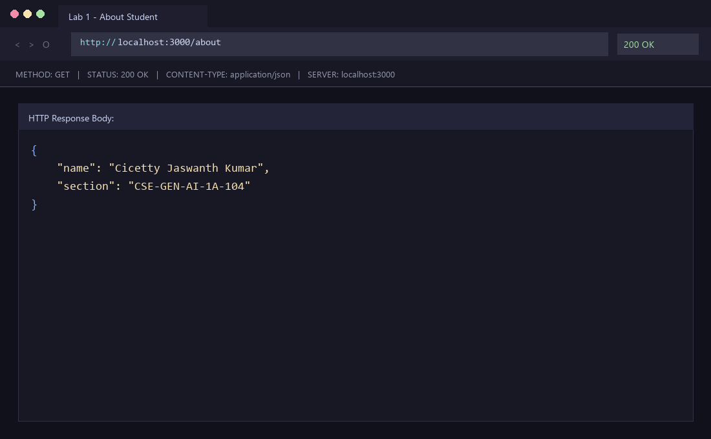
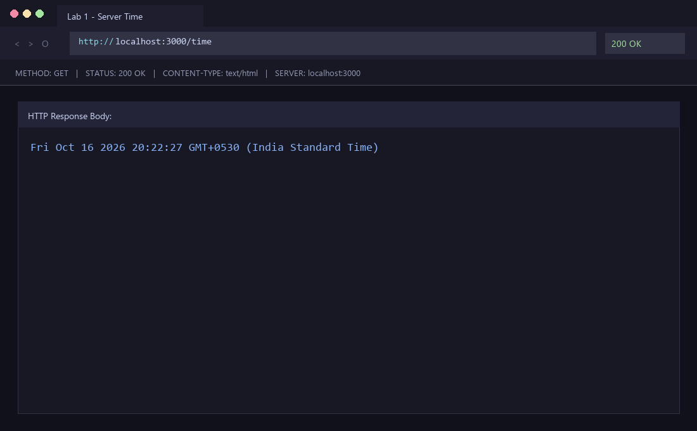
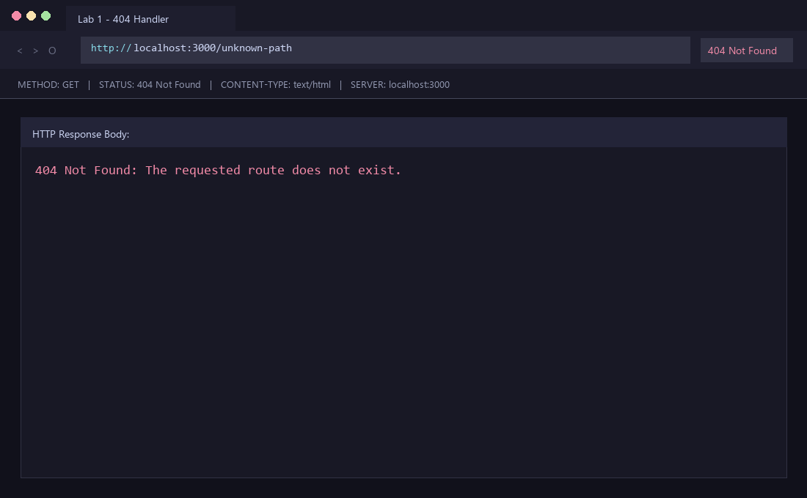

# Lab 1: Node.js and Express Server

## Student Details

- **Name:** Cicetty Jaswanth Kumar
- **Registration Number:** 252U1R9026
- **Section:** CSE-GEN-AI-2A-304
- **Course:** Backend Development Fundamentals, Year II Term II

## Description & Objective

Demonstrate the fundamentals of backend web development using Node.js and Express.js by creating:
1. A plain HTTP server using Node.js's native `http` module (`server-http.js`).
2. A production-ready Express.js server (`server.js`) implementing structured routes, JSON middleware, error handling, and standard HTTP status codes.

## Technologies Used

- **Node.js** (v18+)
- **Express.js** (v5)
- **JavaScript (CommonJS)**
- **Vercel** (Cloud Deployment)

## Deployment

Live Application:
https://backend-development.vercel.app

The application is deployed on Vercel with serverless function routing.

## API Endpoints / Routes

Base URL (Local): `http://localhost:3000`  
Base URL (Production): `https://backend-development.vercel.app`

| Method | Endpoint | Description | Status Code | Response Format |
|---|---|---|---|---|
| `GET` | `/` | Welcome greeting message | `200 OK` | Text (`Welcome to Backend Development Fundamentals - Lab 1 Server!`) |
| `GET` | `/about` | Student identification details | `200 OK` | JSON (`{ name, registrationNumber, section }`) |
| `GET` | `/time` | Current server date and time | `200 OK` | Text (Timestamp string) |
| `GET` | `/*` (unmatched) | Global 404 handler for invalid routes | `404 Not Found` | Text (`404 Not Found: The requested route does not exist.`) |

## How to Install and Run Locally

1. Open a terminal and navigate to the `lab-01` directory:
   ```bash
   cd lab-01
   ```

2. Install dependencies:
   ```bash
   npm install
   ```

3. Start the Express server:
   ```bash
   npm start
   ```
   The server will start listening at `http://localhost:3000`.

4. (Optional) Run the plain Node.js HTTP server:
   ```bash
   npm run start:http
   ```

## Screenshots

The following screenshots verify each endpoint running and returning the expected status and payload:

### 1. Root Route (`GET /`)


### 2. About Route (`GET /about`)


### 3. Time Route (`GET /time`)


### 4. 404 Route Not Found (`GET /not-found-route`)

