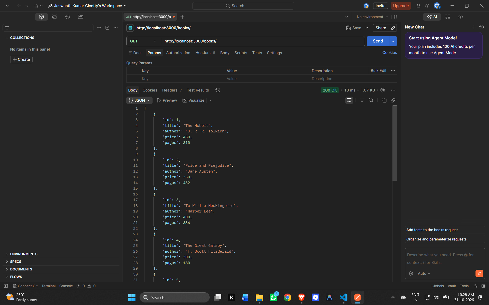
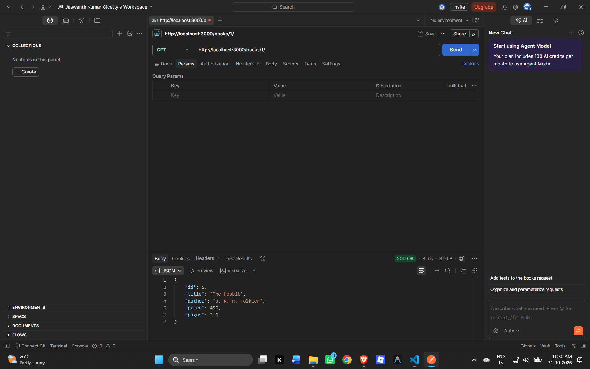
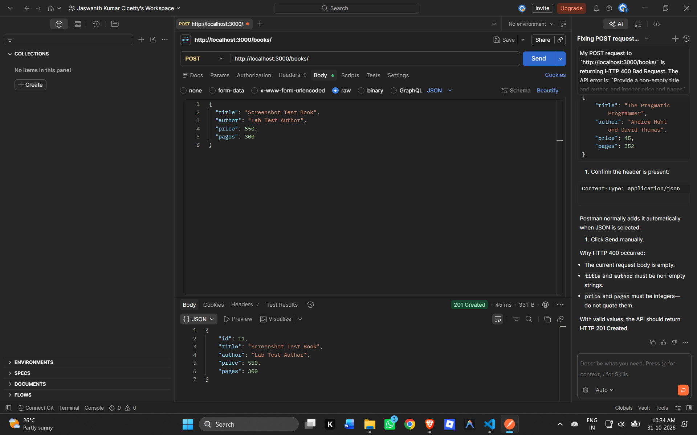
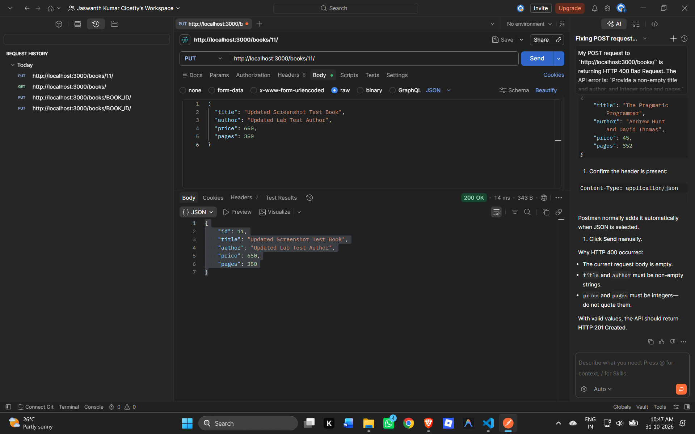
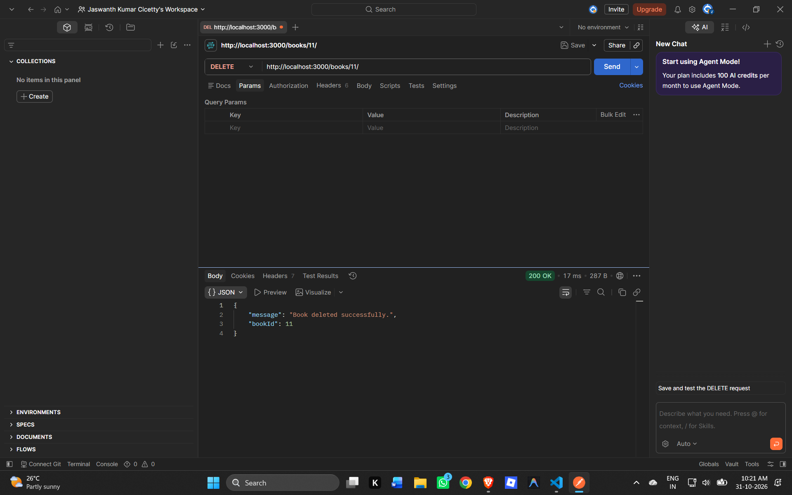
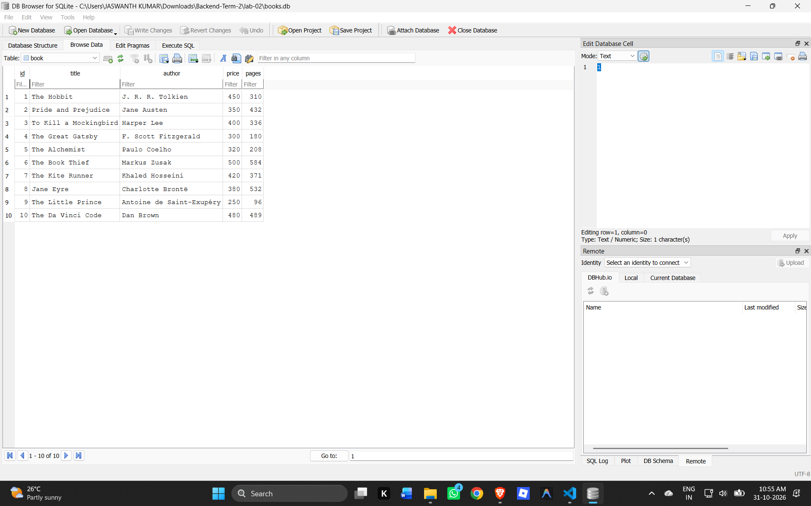

# Lab 2: SQLite database and CRUD routes

**Course:** Backend Development Fundamentals  
**Year/Term:** Year II Term II  
**Content week:** Week 2 (slots 6–12)  
**Module:** SQLite and relational database operations  
**Name:** Cicetty Jaswanth Kumar  
**Registration number:** 252U1R9026  
**Section:** CSE Gen-AI 304 S24  
**Live link:** https://backend-development-0lch.onrender.com  

## Objective & Brief Description

Connect an Express server to a SQLite database and expose full CRUD (Create, Read, Update, and Delete) operations over HTTP. All database queries utilize parameterized SQL statements to safeguard against SQL injection vulnerabilities.

## Technologies Used

- **Node.js** (v18+)
- **Express.js** (v5)
- **SQLite3** (`sqlite3` v6.0.1) & **SQLite Wrapper** (`sqlite` v5.1.1)
- **Nodemon** (v3 for local development)
- **Render** (Cloud Web Service deployment)

## Deployment

Live Application:
https://backend-development-0lch.onrender.com

The application is deployed on Render as a Web Service running Node.js (`npm start`). On startup, the application connects to the SQLite database (`books.db`), creates the `book` table if it does not already exist, and seeds it with initial sample records if empty.

## SQLite Database Information

The database is stored in `books.db` located in the `lab-02/` directory.

### Table Schema: `book`

| Column | Type | Details |
|---|---|---|
| `id` | `INTEGER PRIMARY KEY` | Auto-incremented unique book identifier |
| `title` | `TEXT` | Title of the book (non-empty string) |
| `author` | `TEXT` | Author of the book (non-empty string) |
| `price` | `INTEGER` | Price of the book in INR (integer) |
| `pages` | `INTEGER` | Total page count (integer) |

### Initialization and Seeding

On startup, `initializeDBAndServer()` executes:
1. Connects to `books.db` via `sqlite3.Database` driver.
2. Creates the `book` table using `CREATE TABLE IF NOT EXISTS book (...)`.
3. Checks `SELECT COUNT(*) AS count FROM book`. If the table is empty (`count === 0`), it populates 10 sample books.
4. Starts the Express HTTP listener once the database connection and tables are verified.

## API Endpoints / Routes

Base URL (Local): `http://localhost:3000`  
Base URL (Production): `https://backend-development-0lch.onrender.com`

| Method | Endpoint | Description | Expected Status Codes |
|---|---|---|---|
| `GET` | `/` | Welcome message and API endpoints index | `200 OK` |
| `GET` | `/books/` | Retrieve all books from the database | `200 OK` |
| `GET` | `/books/:bookId/` | Retrieve a single book by ID | `200 OK`, `400 Bad Request` (invalid ID), `404 Not Found` (missing book) |
| `POST` | `/books/` | Create a new book | `201 Created`, `400 Bad Request` (invalid body) |
| `PUT` | `/books/:bookId/` | Update an existing book's details | `200 OK`, `400 Bad Request` (invalid body/ID), `404 Not Found` (missing book) |
| `DELETE` | `/books/:bookId/` | Remove a book by ID | `200 OK`, `400 Bad Request` (invalid ID), `404 Not Found` (missing book) |

## Installation and How to Run Locally

1. Open a terminal and navigate to the `lab-02` directory:
   ```bash
   cd lab-02
   ```

2. Install dependencies:
   ```bash
   npm install
   ```

3. Start the server:
   - For development (with auto-reload):
     ```bash
     npm run dev
     ```
   - For production / standard execution:
     ```bash
     npm start
     ```

The API will listen at `http://localhost:3000` by default (or the port defined by `process.env.PORT`).

## Postman Test Checklist

| Test Case | Method & Route | Expected Status & Result |
|---|---|---|
| List all books | `GET /books/` | `200 OK` with JSON array of books |
| Get single book | `GET /books/1/` | `200 OK` with book object |
| Create a book | `POST /books/` | `201 Created` with created book object including new `id` |
| Update a book | `PUT /books/1/` | `200 OK` with updated book object |
| Delete a book | `DELETE /books/1/` | `200 OK` with deletion confirmation message |
| Missing book | `GET /books/987654321/` | `404 Not Found` |
| Invalid ID format | `GET /books/not-an-id/` | `400 Bad Request` |
| Update missing book | `PUT /books/987654321/` | `404 Not Found` |
| Delete missing book | `DELETE /books/987654321/` | `404 Not Found` |
| Invalid create body | `POST /books/` (`{}`) | `400 Bad Request` |

### Sample POST Request Body:
```json
{
  "title": "The Hobbit",
  "author": "J. R. R. Tolkien",
  "price": 450,
  "pages": 310
}
```

### Sample PUT Request Body:
```json
{
  "title": "The Hobbit - Special Edition",
  "author": "J. R. R. Tolkien",
  "price": 550,
  "pages": 320
}
```

## Screenshots

The following screenshots demonstrate all required endpoints and database verification:

### 1. GET All Books (`GET /books/`)


### 2. GET One Book (`GET /books/:bookId/`)


### 3. POST Create Book (`POST /books/`)


### 4. PUT Update Book (`PUT /books/:bookId/`)


### 5. DELETE Book (`DELETE /books/:bookId/`)


### 6. SQLite Database Table Verification


## Problems Faced and Solutions

- **GLIBC Compatibility on Linux Deployments:** Older `sqlite3` versions (< v6) compiled against newer glibc versions could encounter `/lib/x86_64-linux-gnu/libm.so.6: version 'GLIBC_2.38' not found` on Ubuntu-based deployment environments like Render. Upgraded to `sqlite3` `^6.0.1` which properly links and provides compatibility with Render's Linux runtime.
- **Asynchronous Initialization Order:** Express shouldn't accept incoming traffic before SQLite establishes connection and verifies tables. Solution: Wrapped startup in async `initializeDBAndServer()` so `app.listen()` is only called after SQLite schema check and seeding complete.
- **Idempotent Data Seeding:** Avoided duplicate sample records on server restarts by querying `SELECT COUNT(*) AS count FROM book` and only inserting sample records when `count === 0`.
- **Input Validation & Parameterized Queries:** Added `isValidBook` and `getBookId` helpers to sanitize parameters and used SQL placeholders (`?`) to prevent SQL injection.

## Viva Topics

- **Why await database initialization before calling `app.listen()`?** Ensures tables exist and the connection is ready before any HTTP requests are accepted, preventing unhandled database connection errors.
- **What is SQL injection, and how do placeholders help?** SQL injection occurs when malicious SQL code is concatenated into queries. Placeholders (`?`) treat input strictly as literal values rather than executable code.
- **When is PUT used instead of POST?** `POST` is used to create a new resource where the server typically assigns the ID. `PUT` is used to replace or update an existing resource at a specific target URI.
